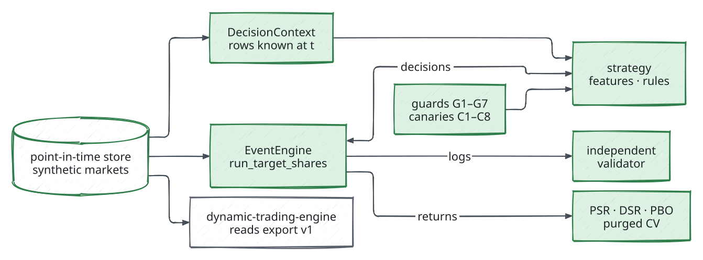
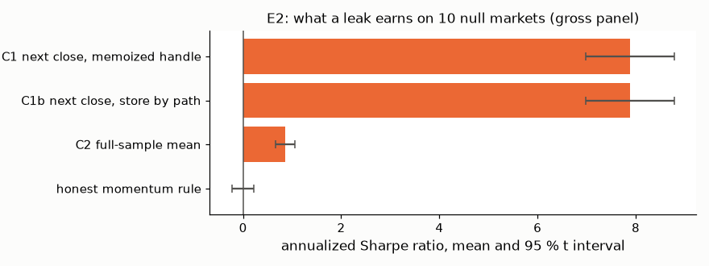
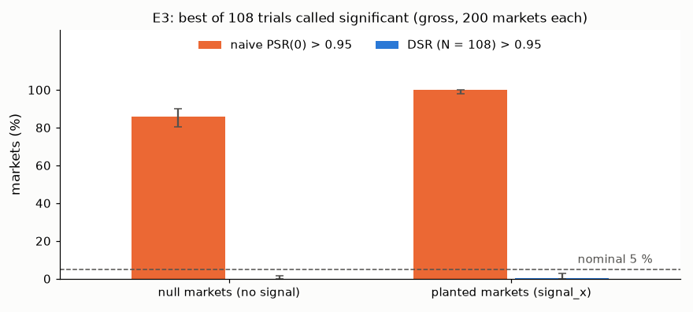

<p align="center"></p>

<p align="center">
<a href="https://github.com/AKASB1/quant-research-engine/actions/workflows/ci.yml"></a>
<a href="LICENSE"></a>


</p>

# quant-research-engine

`quant-research-engine` is a Python research library for honest backtests: a point-in-time store, guarded strategy data access, two cross-checked engines, and selection-aware statistics.

<p align="center"><a href="#install">Install</a> · <a href="#a-first-backtest">A first backtest</a> · <a href="#results">Results</a> · <a href="#evaluation-protocol">Evaluation protocol</a> · <a href="#explore-the-documentation">Documentation</a> · <a href="#limitations">Limitations</a> · <a href="#license">License</a></p>

**Research and simulation software. Not investment advice. No live trading, no broker connectivity.**

> **Synthetic data.** Every result here comes from simulations and backtests on synthetic markets with assumed parameters ([docs/data.md](docs/data.md)), except one labeled illustration on public data.

<a id="what-is-quant-research-engine"></a>
Backtests mislead in two common ways. A strategy reads data that was not known at its decision time, or the best of many trials looks significant by chance. This project makes the first hard to commit by accident and measures the second. One guarded data path leads from a Parquet point-in-time store to a strategy. A replay audit catches strategies that read later data, and canaries that leak on purpose test every guard. An event-driven engine is checked against an independent vectorized engine with exact accounting. The inference tools correct for selection: the probabilistic Sharpe ratio (PSR), the deflated Sharpe ratio (DSR), the probability of backtest overfitting (PBO), and purged validation. The DSR accounts for the number of trials. They are calibrated on synthetic markets where the truth is known. The decision layer, `dynamic-trading-engine`, reads this project's export files and needs no code from it.

<p align="center"></p>

<a id="highlights"></a>
Null markets carry no predictability, so before costs every strategy's true Sharpe ratio there is zero. Planted markets carry a known latent signal, which strategies see only through its noisy published proxy `signal_x`. Gross results set all costs to zero; the E3 and N_eff highlights below are gross.

- **The two engines agree exactly.** Over 1000 random scenarios (956 compared), the event engine and the vectorized engine have 0 fill mismatches. Their largest relative equity difference is 2.1e-14 ([E1](experiments/README.md#e1-engine-and-accounting-audit)).
- **Every canary is caught by its guard.** Each of the 11 canaries (strategies, a feature, a fill rule, and a validation scheme that leak on purpose) is caught by the guard it was written for. No built-in strategy or feature raises an alarm ([E2](experiments/README.md#e2-leakage-audit)).
- **The naive PSR does not account for selection.** On null markets the best of 108 trials has a naive PSR(0) above 0.95 in 86.0 % of markets, where a 5 % test should give 5 %. The DSR with N = 108 exceeds 0.95 in 0.0 % ([E3](experiments/README.md#e3-calibration-of-the-inference-tools)).
- **The DSR with N = 108 has almost no power here.** On planted markets the selected trial uses `signal_x` in 88.5 % of markets, but its DSR exceeds 0.95 in 1 market of 200 ([E3](experiments/README.md#e3-calibration-of-the-inference-tools)).
- **An effective number of trials raises the power.** The 108 trials are correlated, and their effective number N_eff averages 11.0. With N = round(N_eff), the DSR's false-positive rate is 2.0 % and its power 40.0 % ([table](experiments/README.md#effective-number-of-trials-and-multiple-testing-commit-d26a863)).
- **Shuffled K-fold overstates the score.** With overlapping 5-bar labels on null markets, shuffled K-fold overstates the held-out score by 0.260; the bias of purged K-fold is 0.001 ([E5](experiments/README.md#e5-validation-schemes)).

## Install

You need Python 3.12; the dependencies are in `pyproject.toml`. Set up the environment and run the checks. In Windows PowerShell:

```powershell
powershell -ExecutionPolicy Bypass -File scripts\setup_env.ps1
.venv\Scripts\python.exe -m ruff check src tests scripts
.venv\Scripts\python.exe -m ruff format --check src tests scripts
.venv\Scripts\python.exe -m pytest -q
```

On Linux or macOS (bash):

```bash
bash scripts/setup_env.sh
.venv/bin/python -m ruff check src tests scripts
.venv/bin/python -m ruff format --check src tests scripts
.venv/bin/python -m pytest -q
```

Call the shell scripts through `bash`, or run `chmod +x scripts/*.sh` once. Development notes, the CI checks, and how to regenerate results are in [CONTRIBUTING.md](CONTRIBUTING.md).

## A first backtest

The example runs on a generated synthetic store and needs no download. Generate a store, run a built-in strategy on it, and write a report. Then run the leakage audit, export and validate the decision layer's files, and run the experiments. In Windows PowerShell:

```powershell
.venv\Scripts\python.exe -m quant_research_engine synth --config configs/synth/example.json --seed 1 --out outputs/stores/example
.venv\Scripts\python.exe -m quant_research_engine backtest --store outputs/stores/example --strategy quant_research_engine.strategies.signal_x_ls:SignalXLS --warmup 30 --rebalance-every 5 --initial-cash 1000000 --out outputs/runs/example
.venv\Scripts\python.exe -m quant_research_engine report --run outputs/runs/example --store outputs/stores/example --out outputs/reports/example
.venv\Scripts\python.exe -m quant_research_engine audit --canaries tests/canaries --seed 1 --instants 50 --out outputs/audit/audit_table.csv
.venv\Scripts\python.exe -m quant_research_engine export --config configs/synth/planted.json --seed 1 --out outputs/export/planted
.venv\Scripts\python.exe -m quant_research_engine validate outputs/export/planted
.venv\Scripts\python.exe -m quant_research_engine experiment run --quick --workers 2
.venv\Scripts\python.exe -m quant_research_engine experiment run --workers 2
.venv\Scripts\python.exe scripts/plot_results.py
```

On Linux or macOS (bash):

```bash
.venv/bin/python -m quant_research_engine synth --config configs/synth/example.json --seed 1 --out outputs/stores/example
.venv/bin/python -m quant_research_engine backtest --store outputs/stores/example --strategy quant_research_engine.strategies.signal_x_ls:SignalXLS --warmup 30 --rebalance-every 5 --initial-cash 1000000 --out outputs/runs/example
.venv/bin/python -m quant_research_engine report --run outputs/runs/example --store outputs/stores/example --out outputs/reports/example
.venv/bin/python -m quant_research_engine audit --canaries tests/canaries --seed 1 --instants 50 --out outputs/audit/audit_table.csv
.venv/bin/python -m quant_research_engine export --config configs/synth/planted.json --seed 1 --out outputs/export/planted
.venv/bin/python -m quant_research_engine validate outputs/export/planted
.venv/bin/python -m quant_research_engine experiment run --quick --workers 2
.venv/bin/python -m quant_research_engine experiment run --workers 2
.venv/bin/python scripts/plot_results.py
```

Every command writes under the git-ignored `outputs/`, except the experiments and the figures. `experiment run` without `--quick` runs every registered experiment and writes `experiments/results/<experiment>/`; `--only e1,e2` selects some. `--quick` uses development seeds and small sizes and writes only to the ignored `experiments/outputs/quick/`. `scripts/plot_results.py` draws the figures in `docs/figures/` from the committed results. `backtest` lints a strategy given as a file (`path/to/file.py:Class`) with guard G3 first.

## How it works

- The point-in-time store keeps `ts_event` and `ts_avail` on every row. It holds vintaged series with revisions, prices adjusted as of the decision instant, and instruments that later delist ([docs/data.md](docs/data.md)).
- `DecisionContext` is a strategy's only data path: read-only copies of the rows known at the decision instant. Guards G1 to G7 check strategies, features, fills, splitters, and the universe, and eleven canaries test them ([docs/lookahead.md](docs/lookahead.md)).
- `EventEngine` fills at the next open or close, with fill delays, a participation cap, shorts, splits, dividends, and delistings. The vectorized `run_target_shares` shares only the cost function and the quantity rounding with it.
- The accounting identity is asserted on every bar, and an independent validator re-derives the accounting from the logs.
- The inference tools are PSR, SR0, DSR with a trial registry, and PBO by combinatorially symmetric cross-validation. SR0 is the expected maximum Sharpe ratio of N independent trials with zero true Sharpe ratio. The resampling and validation tools are the stationary bootstrap, purged K-fold with embargo, walk-forward, and combinatorial purged cross-validation (CPCV) ([docs/inference.md](docs/inference.md)).
- The synthetic generator plants a known predictability, with null settings, events, regimes, Student-t tails, and distribution shift.

The modules and the flow of a backtest: [docs/architecture.md](docs/architecture.md).

## Results

Each experiment ran once on the commit in the table, and its results are in `experiments/results/<experiment>/` with a manifest. For E1 to E5 the headline measure was fixed before the run; each later experiment's configuration was fixed before its run ([protocol](experiments/README.md#protocol)).

| Experiment | Question | Headline | Commit |
|---|---|---|---|
| E1 engines and accounting, 1000 scenarios | Do the two engines and the validator agree? | 0 fill mismatches and 0 violations; largest relative equity difference 2.1e-14 | `a1a0011` |
| E2 leakage audit, 22 subjects | Does each guard catch its canary? | every canary caught by its named guard; no alarm on the built-ins | `a1a0011` |
| E3 calibration, 200 null and 200 planted markets | How often is the best of 108 trials called significant? | null, gross: naive PSR(0) > 0.95 in 86.0 %, DSR > 0.95 in 0.0 %; mean PBO 0.48 | `a1a0011` |
| E4 costs, base case | How much of the gross Sharpe ratio survives costs? | annualized net 0.09 ± 0.22 against gross 1.42 ± 0.19 | `a1a0011` |
| E5 validation schemes, h = 5 | How far is each scheme's score from a held-out segment? | shuffled K-fold +0.260, purged K-fold +0.001 (null markets) | `a1a0011` |
| E5b CPCV | Does CPCV estimate better than the other purged schemes? | not distinguishable from them; shuffled K-fold +0.257 | `6892cb1` |
| Capacity of `signal_x_ls`, 10 planted markets | At what capital does the net Sharpe ratio vanish? | 0.48 at 1 million; half at 3.18e+06, zero at 1.01e+07 | `df91f7c` |
| Effective number of trials | Does a DSR with N_eff keep false positives low and gain power? | false positives 2.0 %, power 40.0 % (N = 108: 0.0 %, 0.5 %) | `d26a863` |



*What a leak earns where nothing can be earned honestly: on null markets the honest rule's true Sharpe ratio is zero. The audit table, the detection curve, and the same-bar fill comparison are on the [results page](experiments/README.md#e2-leakage-audit).*



*The best of 108 trials, gross panels, with 95 % Wilson intervals; the dashed line is the nominal 5 %. The full calibration figure (SR0, PBO, bootstrap coverage, Lo adjustment) is on the [results page](experiments/README.md#e3-calibration-of-the-inference-tools).*

Key assumed parameters ([docs/data.md](docs/data.md#assumed-parameter-values)):

| Assumption | Value |
|---|---|
| E3 markets | 60 instruments by 1260 bars |
| Information coefficient of the latent signal | 0.02 |
| Signal persistence | 0.9 |
| Overnight share of each bar's return | 0.25 |
| Costs | cost model v1 with its default parameters |
| Vectorized runs | fixed capital of 10 million |

The only result on real data is the Kenneth French illustration, labeled "illustration, no claims" ([results page](experiments/README.md#kenneth-french-illustration-commit-0ea0e9b-illustration-no-claims)).

## Evaluation protocol

- Each experiment has a fixed seed range; the effective-number-of-trials experiment reuses E3's markets. Development, tests, and `--quick` use seeds 1 to 99, which never appear in the results.
- The protocol, grids, sizes, tolerances, and headline numbers were fixed before the full run.
- E1 to E5 ran once, on commit `a1a0011`; each later experiment ran once, on its own commit.
- Means carry 95 % Student-t intervals across markets or seeds, shares carry Wilson intervals, and paired differences are used where seeds are shared. Gross panels are the calibration; net panels are labeled.
- Results are byte-identical for the same configuration and seed on one platform with the same package versions. Across platforms they agree numerically ([details](experiments/README.md#reproducibility-across-platforms)).

## Project layout

```text
src/quant_research_engine/
  data/        schemas, loaders, validators, writers, manifests
  store/       Parquet store, DuckDB, as-of, adjustment, liquidity, calendars, CSV adapter, registry
  synth/       synthetic market generator
  context/     DecisionContext, ContextBuilder, decisions, Strategy
  features/ signals/ portfolio/ strategies/
  costs/ engine/ vector/ backtest/ attribution/ validation/
  guards/      poison, replay audit, lint, availability audit, audit table
  metrics/ inference/
  experiments/ reports/ export/ cli/
tests/         checks 1-18, canaries (tests/canaries), fixtures (tests/data)
configs/       synthetic market configurations
experiments/   configs (frozen), results (committed), outputs (ignored)
docs/          architecture, contracts, lookahead, inference, data, figures, diagram source, icon, examples
scripts/       setup_env, figures, diagram, icon, microbenchmarks
.github/       CI workflow
```

## Explore the documentation

- [docs/architecture.md](docs/architecture.md): the modules, the knowledge-time rule, the flow of a backtest, and the two engines.
- [docs/contracts.md](docs/contracts.md): the shared contract with the decision layer (quant-contracts version 1).
- [docs/lookahead.md](docs/lookahead.md): the guards, the canaries, the audit table, and what the audit cannot prove.
- [docs/inference.md](docs/inference.md): metrics, selection-aware inference, known answers, and the E3 calibration.
- [docs/data.md](docs/data.md): the synthetic market, the assumed parameter values, the adapters, and third-party terms.
- [experiments/README.md](experiments/README.md): how to reproduce, the protocol, every result table, the figures, and the detailed limitations.
- [IMPLEMENTATION.md](IMPLEMENTATION.md): the research rules as implemented and the delivery order.
- [CONTRIBUTING.md](CONTRIBUTING.md): development setup, checks, and regenerating results.

## Limitations

- Every result comes from synthetic markets with assumed parameters, except one labeled illustration.
- Small samples in places: 10 markets for the leak Sharpe ratios, one trial grid of 108 for E3.
- Results are byte-identical on one platform and agree only numerically across platforms.
- Not built: factor exposure attribution, intraday bars, nested validation, exports at three sizes.

Further limitations: [experiments/README.md](experiments/README.md#limitations).

## Related projects

- [microsoft/qlib](https://github.com/microsoft/qlib): an AI-oriented quantitative investment platform covering data preparation, forecasting models, and the path from research to production. This project works on synthetic markets with known truth and focuses on look-ahead guards and selection-aware inference.
- [stefan-jansen/zipline-reloaded](https://github.com/stefan-jansen/zipline-reloaded): an event-driven backtesting library for historical market data through data bundles and a pipeline API. This project checks its event engine against an independent vectorized engine and audits strategies for look-ahead.
- [nautechsystems/nautilus_trader](https://github.com/nautechsystems/nautilus_trader): a multi-asset trading engine with a Rust core that runs the same event-driven code in backtests and live trading. This project is Python research software for honest backtest statistics.
- [polakowo/vectorbt](https://github.com/polakowo/vectorbt): vectorized backtesting and trading research on NumPy and Numba.

Their code was not read for this repository, and nothing was copied from them.

## License

MIT, see [LICENSE](LICENSE). Third-party data is not included; its terms are in [docs/data.md](docs/data.md#third-party-sources-adapters).
